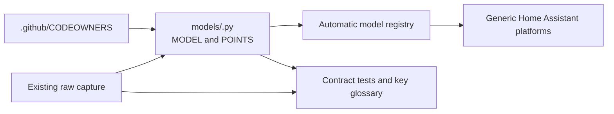

# Contributing

## Add a model

Each inverter profile lives in one file under
`custom_components/deye_ble/models/`. The package discovers modules that export
a `MODEL`; do not add a central registry entry or edit shared platform tables.

1. Add a model module with a stable `id`, display `name`, claimed
   `device_types`, `POINTS`, and a `MODEL` built from the shared descriptors in
   `models/base.py`.
2. Use one `Point` per decoded value. Declare its raw `Read`, its presentation
   `show`, and its verified `Write` where supported. Every write must name the
   exact inverter model in `verified_on`. Gate clock writes with
   `Capabilities(clock_writable=True)` only after they are verified.
3. Reuse the existing raw capture fixtures where they apply. Add the new
   profile's capture mapping to `tests/contracts/captures.py`; keep decoded
   words as the captured fixture source rather than copying expected values.
4. Add a semantic entry for every model point in
   `tests/contracts/key_glossary.py`. Describe what a key measures, including
   distinctions such as PV/DC temperature versus AC-side temperature. Pin the
   source registers for ambiguous keys so register drift fails the contract.
5. Add one CODEOWNERS line for the model file. Extend existing profile tests
   only when the new model needs specific behavior beyond the shared contracts.
6. Run `pytest tests/contracts` while developing, then run the full suite with
   `pytest`.

The contracts check registry claims, derived read blocks, capture coverage,
key meanings, verified writes, and clock capabilities for every discovered
model. Each guard also has a deliberately broken model fixture to show that the
check detects the failure.

Read blocks are grouped automatically: registers in the same tier are merged
into blocks of up to 16, so a block can include addresses no point uses. The
three-phase hybrid accepts this. If a new model rejects such a gap address, the
whole block fails to read. Test on hardware and look for sensors that stay
unavailable.
