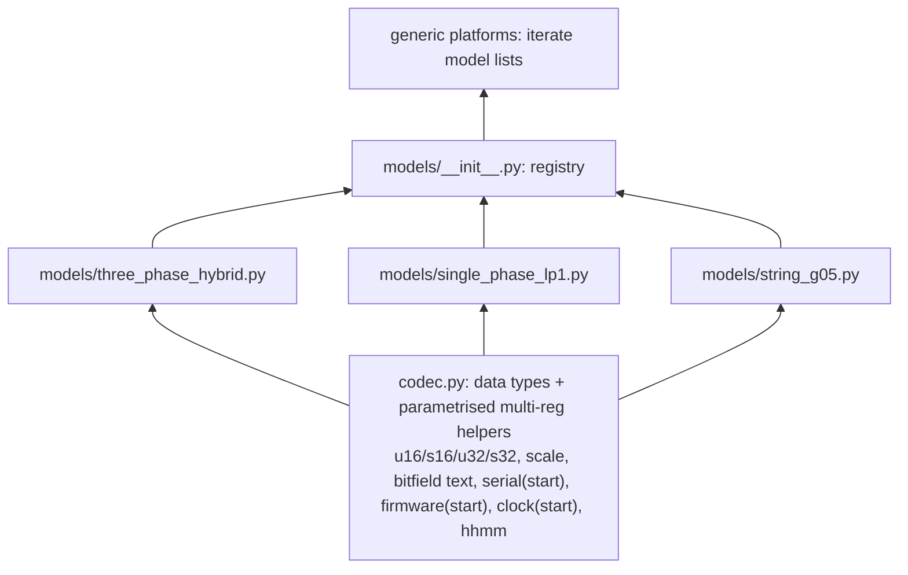
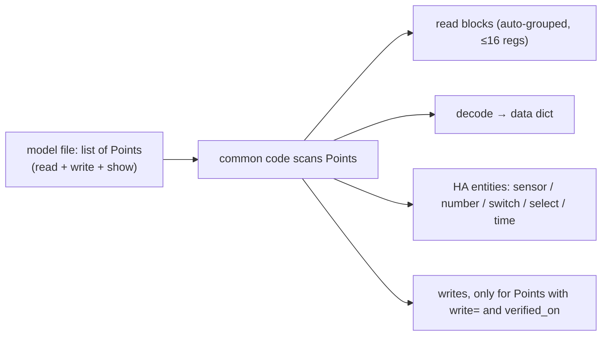
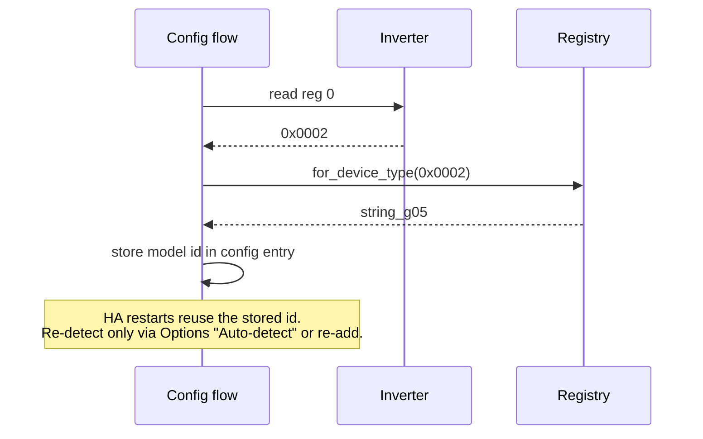

# Multi-model profile design (draft for review)

Status: agreed direction with the owner on 2026-11-07, pending independent review.
Trigger: PR #11 (three-phase on-grid string inverter, SUN-6K-G05, device type 0x0002, Modbus V118).

## Problem

- `registers.py` (801 lines) holds the blocks, decode maps and register constants for all profiles.
- Platform files (sensor, binary_sensor, number, switch, time) branch on profile identity: `is_single_phase`, `is_string`, `== PROFILE_THREE_PHASE`, `!= PROFILE_THREE_PHASE`. Every new model adds a branch to each of them, and contributors edit the same lines.
- PR #11's `decode_string` copies about 40 lines of `decode_single_phase` (serial, firmware, MPPT, clock, state, alarm/fault bits).
- Key drift: `inverter_temp` means reg 90 (DC) on single-phase but reg 91 (AC) on string.
- Capabilities are implicit: the Sync Clock button, the `sync_clock` service and the clock automation all write the clock on string even though the write is unverified there.
- The Options dropdown (config_flow.py), the reassert maps (helpers.py) and the platform tables are built centrally and routed per model.

## Design



1. **codec.py:** how raw words become values. Knows no register addresses. Holds the repeated multi-register *logic* as functions that take a starting register: `serial(words, 3)`, `firmware(words, 10)`, `bitfield_text(words, 101, 2, BITS)`, `clock(words, 22)`.
2. **models/<name>.py:** one file per model. It declares:
   - `id`, `device_types` (register-0 values claimed)
   - `blocks` per tier (live/fast/slow, ≤16 regs each)
   - `decode(words)`: its own register table + codec calls
   - `sensors`, `flags`, `controls` (rows), `caps` (`has_battery`, `has_tou`, `clock_writable`, `cloud_time_sync`)
   - `ControlDesc.kind` ∈ {number, bitflag, enum, hhmm} plus a required `verified_on` and per-model min/max/signedness
   - Controls that don't fit one row (three-phase Discharge SOC writes 5 TOU registers) stay as explicit special core controls that the model opts into
   - Drift/reassert metadata (register ↔ key, enum maps) comes from the model's controls, not from shared tables in helpers.py
3. **Registry:** auto-discovers every module in `models/` (pkgutil), so adding a model needs no shared edit. It provides `for_device_type(raw)` (unclaimed → three_phase_hybrid fallback, as today), `get(id)`, and `choices()` for the Options "Inverter type" dropdown. It raises on duplicate claims.
   Everything user-facing is **generated from the models**: the dropdown, entities, controls and drift/reassert metadata. Nothing is built once centrally and then routed per model.
4. **Platforms:** one generic entity class per control kind. They loop over model lists and never name a model. Special entities (TOU schedule, clock drift, daily consumption, grid connected) stay as core classes, gated by caps/keys.
5. **No shared register "families".** With three models it's YAGNI. Models copy register **tables** (data), never logic. Rule of three: extract a shared table only when a third model would copy it.


## One declaration per data point

Each model file is a **mapping**: one row per data point that says how to **read** it, how to **write** it (if at all) and how to **show** it. Common code scans the rows and builds the decode, the HA entities and the write controls. Today these three facts live in three places (decode map, sensor table, control class), which is where key drift comes from.

```python
# models/string_g05.py
POINTS = [
    Point("grid_voltage_l1", read=u16(73, 0.1), show=Sensor("Grid Voltage L1", "V", VOLTAGE)),
    Point("inverter_ac_temp", read=u16(91, 0.1, offset=1000), show=Sensor("Inverter AC Temperature", "°C", TEMPERATURE)),
    Point("total_solar", read=u32(63, 0.1), show=Sensor("Solar Total", "kWh", ENERGY, TOTAL_INCREASING)),
    Point("alarm", read=bitfield_text(101, 2, ALARM_BITS), show=Sensor("Inverter Alarm")),
]

# models/three_phase_hybrid.py (a writable point)
Point("max_sell_power", read=u16(0x8F), show=Number("Max Sell Power", "W", 0, 12000, step=100),
      write=Write(verified_on="SUN-12K-SG04LP3"))
```



- Read blocks are **derived** from the points' registers and tiers, not hand-listed. The ≤16-register rule lives in common code.
- Odd cases (three-phase Discharge SOC writing 5 TOU registers, TOU schedule, derived PV power) use a `custom=` hook on the point, or a special core entity the model opts into.

## Startup and detection (unchanged behaviour)



## Guards (contract tests over every model)

- Device types unique across models
- Blocks 1-16 regs, non-overlapping
- Each model ships `tests/models/<name>/capture.json` (live raw words + expected values); every sensor key is produced by decoding it
- Key glossary with **meaning** (e.g. `inverter_dc_temp` = DC side, `inverter_ac_temp` = AC side), not just unit/device_class. Unit checks alone would miss reg 90 vs 91.
- Every control has `verified_on`
- Clock writes are refused **in the coordinator** unless `caps.clock_writable`. This covers the button, the `sync_clock` service and `deploy/deye_clock.yaml`, not just the button.
- Golden file of entity keys + unique IDs per model (pins user-visible behaviour)
- CODEOWNERS per model file

## Migration (one PR per step, suite green each time)

0. Merge #11 with small fixes: block clock writes for string in the coordinator (not just the button); give the string AC temp (reg 91) a new key `inverter_ac_temp` so no shipped key changes; test/document the transport console discovery (or split it out).
1. Golden-file test of entity keys and unique IDs per profile, from captures.
2. Create `codec.py` + `models/`; move code as-is; `registers.py` re-exports (no logic change).
3. Models own sensors/flags/controls/caps; platforms iterate; delete `is_*` branches; the 15 bespoke number classes become ControlDesc rows.
4. Move repeated multi-reg logic into codec helpers; dedupe decode_single_phase/decode_string. (The temp-key clash is already avoided in step 0, so no entity migration is needed.)
5. Contract tests, CODEOWNERS, CONTRIBUTING.md "add a model".
6. Remove the `registers.py` shim.

Unique IDs (logger SN + key) never change.

## Out of scope / rejected

- YAML register files (ha-solarman style): loses typing and test ergonomics
- Runtime plugins or external packages
- Inheritance trees between models
- Shared register families (revisit at the third copy)
